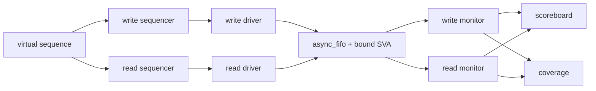
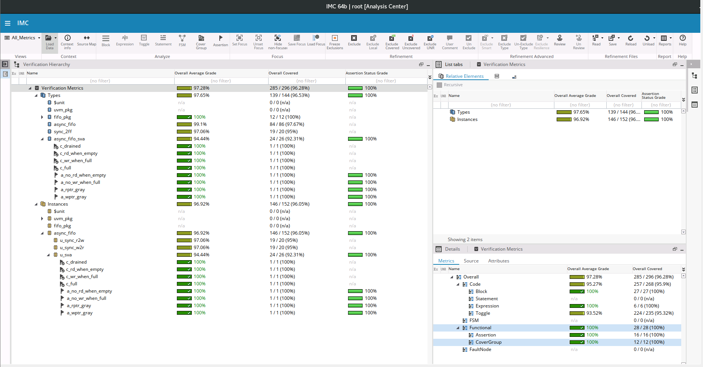

# Asynchronous FIFO: RTL Design and UVM Verification

A dual-clock FIFO in SystemVerilog, verified with a UVM testbench on Cadence Xcelium.
The write and read sides run on unrelated clocks; only Gray-coded pointers cross between them,
through 2-flop synchronizers.

**Results:** 12-run regression (3 tests × 4 clock ratios), all passing.
100% functional coverage and 100% block and expression coverage on the RTL.

---

## Design

| Parameter | Value |
| --- | --- |
| Data width | 8 bits |
| Depth | 16 entries |
| Pointers | 5 bits (one extra bit to tell full from empty) |
| Read style | Show-ahead (`rdata` shows the oldest entry while not empty) |

How it works:
- Each side keeps a binary pointer (to address memory) and a Gray copy (to send across).
  Gray code changes one bit per increment, so a synchronized pointer is always either the old
  or the new value, never a mix.
- **Empty** (read side): next read pointer equals the synchronized write pointer.
- **Full** (write side): next write pointer equals the synchronized read pointer with its top two
  bits inverted (one lap ahead, in Gray code).
- Both flags are **pessimistic**: each side sees the other's pointer 2-3 clocks late, so it may
  report full or empty slightly too long. That costs a few cycles but can never overflow or
  underflow the FIFO.

## Testbench



| Part | What it does |
| --- | --- |
| Two agents | One per clock domain (`wr_agt` on wclk, `rd_agt` on rclk), same class configured by `is_write` |
| Driver | Two modes: **stress** (fires writes even when full, to check they are ignored) and **backpressure** (holds a write until accepted, like a real producer) |
| Monitors | Report every request and whether the DUT accepted it |
| Scoreboard | Queue reference model; checks data, order, overflow, underflow and leftovers. Does not predict flag timing, since the flags are legally late |
| Coverage | FIFO occupancy (empty to full), write while full, read while empty, corner data values |
| SVA (bound with `bind`) | Pointers change at most one bit per clock; pointers do not move on write-while-full or read-while-empty; 4 cover properties |
| Watchdog | `set_timeout` turns a hung test into a fatal error instead of a stuck job |

### Tests

| Test | Scenario |
| --- | --- |
| `fifo_random_test` | Random writes and reads in parallel (stress mode), then drain |
| `fifo_full_empty_test` | Fill past full, then read past empty, 4 times |
| `fifo_backpressure_test` | Writer waits on full; every write must arrive |

Each test runs at 4 clock ratios (wclk / rclk, in ns): 10/27, 27/10, 10/10, 7/50.

## Results

### Regression (12 runs, all PASSED)

Accepted writes per run (stress mode drops writes while full by design; backpressure must accept all 300):

| Test | 10/27 | 27/10 | 10/10 | 7/50 |
| --- | --- | --- | --- | --- |
| random (stress) | 122 | 124 | 299 | 52 |
| full_empty | 64 | 64 | 64 | 64 |
| backpressure | 300 | 300 | 300 | 300 |

Every accepted write was read back in order with no scoreboard errors and no assertion failures.

### Coverage (merged over all 12 runs, code coverage on the DUT only)

| Metric | Result |
| --- | --- |
| Covergroups | 12 / 12 bins (100%) |
| Assertions | 4 / 4 never failed; 4 / 4 cover properties hit |
| Block | 100% |
| Expression | 100% (`winc && !wfull`: all 3 cases) |
| Toggle | All bits except the reset signals' 1→0 transition |

The only uncovered items are reset toggles: no test re-asserts reset during traffic.
See [Known limitations](#known-limitations).

Raw reports are in [`results/`](results/).



*Merged coverage from all 12 runs in Cadence IMC. Read the **Instances → async_fifo** row (146/152): every
assertion passed and every cover property was hit, and all 6 missed items are reset 1→0 toggles. The top
"Verification Metrics" row adds Types and Instances together, so it counts the same code twice.*

## Bugs found during verification

All three were in the testbench, and each was found from regression results, not by reading code.

1. **Coverage hole on corner data values.** Uniform random data hits `0x00` or `0xFF` once in 256
   writes, so some seeds missed them. Fixed with a weighted `dist` constraint.
2. **Deadlock in the backpressure test.** With a slow writer and a fixed number of reads, the reads
   finished early, the FIFO filled, and the waiting writer blocked forever. Fixed by reading until
   the writer is done, and added a timeout watchdog.
3. **A write lost right after reset.** One run accepted 299 of 300 writes with no error. The driver
   issued a clocking-block drive in the middle of a cycle after reset, which only takes effect at
   the next edge, so the first write never reached the pins. Reproduced with the failing seed and
   fixed by aligning the driver to a clock edge after reset.

## Run it

Needs Cadence Xcelium with UVM 1.2.

```bash
cd sim
make                                   # fifo_random_test, wclk 10 ns, rclk 27 ns
make TEST=fifo_backpressure_test
make WCLK=27 RCLK=10                   # slow writer, fast reader
make SEED=<seed>                       # repeat a run exactly
make regress                           # 3 tests x 4 clock ratios
imc -exec cov.tcl                      # merge coverage and print a report
```

## Repository layout

```
rtl/        async_fifo.sv, sync_2ff.sv
sva/        async_fifo_sva.sv (assertions + bind)
tb/
  if/         interface with clocking blocks
  fifo_pkg.sv package that includes every class
  seq_items/  transaction
  sequences/  write, read and virtual sequences
  agent/      driver, monitor, agent
  env/        scoreboard, coverage, env
  tests/      base, random, full_empty, backpressure
  top/        tb_top (clocks, resets, DUT, run_test)
sim/        filelist.f, Makefile, probe.tcl, cov.tcl
results/    regression summary and coverage report
```

## Known limitations

- **No mid-run reset test.** Resetting only one clock domain while the other has data would leave
  the pointers disagreeing (stale or duplicated reads, false full). Real designs reset both domains
  from one source, asserted asynchronously and released per domain. A test that resets both
  domains during traffic is the next step and would close the remaining toggle items.
- RTL simulation has no metastability, so CDC correctness rests on the Gray-code assertions and the
  design structure, not on random tests. A CDC tool would be the proper sign-off check.
